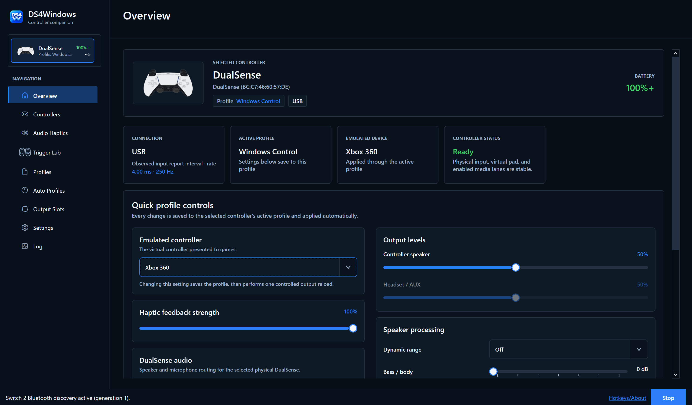

# DS4Windows 5

Controller remapping, advanced feedback, and per-game profiles for Windows.

[**Download**](https://github.com/Pav-Osmolski/DS4Windows/releases) · [Documentation](docs/README.md) · [Changelog](CHANGELOG.md) · [Community](https://www.reddit.com/r/DS4Windows/) · [Support on Ko-fi](https://ko-fi.com/devilhood42)

## Why this fork exists

This fork continues DS4Windows development with a focus on usability, reliability and ongoing maintenance. The aim is to make its extensive controller features easier to configure and troubleshoot, while keeping the application, VIIPER backend and updater working together.

Major improvements include:

- **A clearer, consistent interface:** Searchable Settings with remembered navigation, a reorganized Profile Editor, clearer Controller Readings and live readings alongside Axis Config. Improved spacing, scrolling and Dark/Light theme consistency across the app.
- **More useful Output Slots:** Clear slot numbers and controller information, wrapping text, automatic column fitting and remembered manual widths, with smoother resizing.
- **Safer profile handling:** Preserve existing profiles when saves fail, explain save and rename errors, and offer retry/discard controls for unsaved Overview changes. Reliably save enabled Special Actions and reduce profile-switching overhead.
- **More reliable controller cleanup:** Improve Bluetooth and DualShock 3 disconnect/reconnect handling. Retain failed virtual-controller removals for retry, protect replacement bindings, and continue shutdown when another controller or notification handler fails.
- **More predictable controller feedback:** Respect profile lightbar settings during native DualSense feedback while preserving haptics and adaptive triggers. Add per-profile player/microphone indicators with application pass-through and explicit reapply controls. Correct touchpad-click remapping and passthrough, preserve partial virtual DS4 feedback, and improve virtual keyboard/mouse state handling.
- **Updated USB/IP and VIIPER integration:** Support the latest usbip-win2 release with a matching, verified VIIPER backend, reviewed upstream improvements, stronger startup checks and controller-import safeguards. Add a saved option to hide VIIPER’s tray icon.
- **Better diagnostics:** Report USB/IP and HidHide versions, driver states, backend readiness and installed/portable mode. Provide copyable logs, a built-in four-slot XInput controller test, clearer disconnect and repair diagnostics, and optional Profile Editor timing information.
- **Maintained updates, releases and documentation:** Integrate this fork’s DS4Updater for installed and portable updates. Provide illustrated guides, matching source archives, dependency notices, checksums and build records, backed by reviewed dependency updates, extensive automated tests and installer upgrade checks.

The fork builds on the work of [hbashton's DS4Windows](https://github.com/hbashton/DS4Windows) and the wider DS4Windows community. Upstream fixes retain their attribution, and improvements suitable for upstream contribution are prepared separately for review.

See the [Changelog](CHANGELOG.md) for release-by-release details and [Documentation](docs/README.md) for setup and usage.

## Features

- Remap buttons, sticks, touchpad, keyboard, mouse, macros, and special actions.
- Save per-game profiles and switch them automatically by application or window title.
- Configure gyro aiming, including stick-based activation/pause, lighting, rumble, audio haptics, and adaptive triggers.
- Receive native DualSense advanced haptics and adaptive-trigger feedback in supported games, including over Bluetooth.

Supported inputs include DualShock 3/4, DualSense/Edge, Switch Pro, Joy-Con,
Switch 2 Pro, and Joy-Con 2. Outputs include Xbox 360, Xbox One/Series,
DualShock 4, DualSense/Edge, and Switch 2 Pro. Features depend on the
controller, connection, and game.

## Get started

**Moving from another DS4Windows fork, including hbashton's?** Back up your
profiles and settings, disable the old copy's startup entry, and uninstall the
old installed app or retire its portable folder before using this fork.

Setup handles replacement of an incompatible USB/IP package and may require a
Windows restart before continuing. Follow the
[clean migration steps](docs/getting-started.md#moving-from-another-fork).

Routine updates of this fork do not require uninstalling it first.

1. Download the **x64 Setup EXE** from [Releases](https://github.com/Pav-Osmolski/DS4Windows/releases).
2. Follow setup to install the bundled VIIPER backend and USB/IP driver. HidHide helps prevent double input; restart if prompted.
3. Connect your controller and choose a profile and emulated controller. Avoid overlapping Steam Input remapping for the same game.

**Requirements:** Windows 10 or 11 x64 and the [Visual C++ x64 runtime](https://aka.ms/vs/17/release/vc_redist.x64.exe). The .NET runtime is included.

For portable use, extract the entire `DS4Windows_<version>_x64.zip`, keeping the
`Lang` folder with the app. See [Documentation](docs/README.md) for
setup, update instructions, and troubleshooting. Read the release notes for
signing status and known limitations.

## Support development

If this fork is useful to you, you can [support Pawel's ongoing work on Ko-fi](https://ko-fi.com/devilhood42). Contributions help support maintenance, bug fixes, controller testing and continued development of this independent fork. Support is entirely optional; DS4Windows remains free and open source.

## Project links

[Report a bug](https://github.com/Pav-Osmolski/DS4Windows/issues) · [Contribute](contributing.md) · [Contributors](contributors.md) · [VIIPER backend](https://github.com/Pav-Osmolski/VIIPER) · [DS4Updater](https://github.com/Pav-Osmolski/DS4Updater)

Use the matching backend bundled with DS4Windows. The updater is optional
when downloading and installing updates manually.

Thanks to hbashton, Jays2Kings, Ryochan7, Schmaldeo, the DS4Windows community,
and the contributors to VIIPER, HidHide, usbip-win2, and controller research.

Licensed under [GPL-3.0](COPYING). See [third-party notices](NOTICE.txt).
