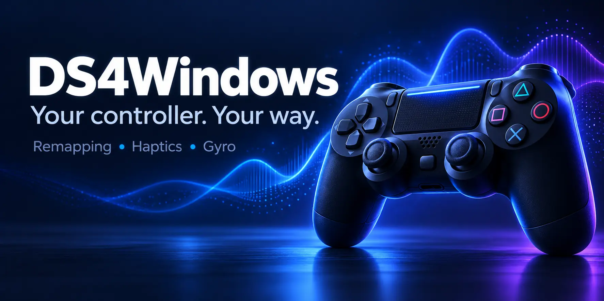
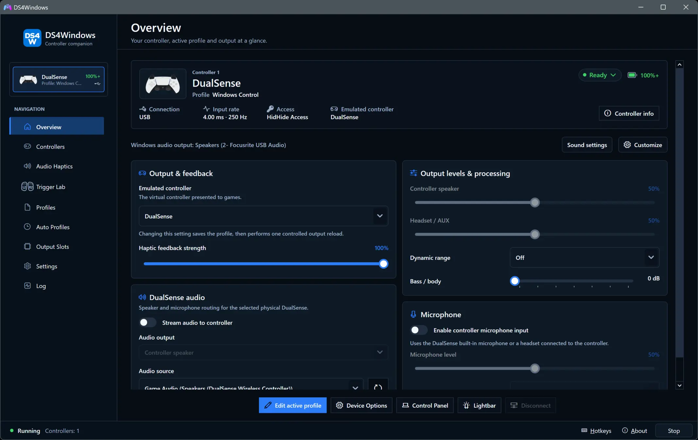

# DS4Windows 5

Controller remapping, advanced feedback, and per-game profiles for Windows.

**Published by [Pav-Osmolski](https://github.com/Pav-Osmolski).**

[**Website**](https://pav-osmolski.github.io/DS4Windows/) · [**Download**](https://github.com/Pav-Osmolski/DS4Windows/releases) · [Documentation](docs/README.md) · [Changelog](CHANGELOG.md) · [Community](https://www.reddit.com/r/DS4Windows/) · [Support on Ko-fi](https://ko-fi.com/devilhood42)

## Why this fork exists

I’m building this fork as the actively maintained successor to earlier DS4Windows versions. The work focuses on fixing long-standing controller, profile and connection bugs and adding features users have asked for. DS4Windows, its VIIPER backend and DS4Updater are maintained together so setup, controller emulation and updates work as a matched package.

### Major improvements

- **A clearer, more consistent interface.** Search Settings and return to the last page you used. The reorganised Profile Editor puts live readings alongside Axis Config, with more consistent spacing, scrolling and light and dark themes across the app.
- **More readable Output Slots.** See which physical controller feeds each numbered slot. Long names wrap, and fitted or saved column widths appear on the first frame.
- **Safer profile editing.** A failed save or rename preserves the original profile. Retry or discard unsaved Overview changes. Enabled Special Actions save reliably, and reusing the profile serializer cuts overhead when switching profiles.
- **Broader controller compatibility.** Adds USB and Bluetooth input for Switch 2 Pro and the official wireless GameCube Controller for Switch 2, plus Bluetooth support for standalone and paired Joy-Con 2. DualShock 3 mappings can retain pressure sensitivity when mapped to analogue triggers or stick axes. [Controller compatibility](docs/controller-compatibility.md)
- **More reliable reconnects and shutdown.** Bluetooth and DualShock 3 reconnects recover more reliably after a disconnect. Failed virtual-controller removals can be retried, replacement bindings are protected, and shutdown can continue if one device fails to clean up.
- **More predictable feedback and passthrough.** Native DualSense haptics and adaptive triggers can run alongside profile lightbar settings and configurable player and mute indicators. Fixes cover touchpad-click remapping and passthrough, partial DualShock 4 feedback packets, and virtual keyboard and mouse state. [Controller audio and feedback](docs/controller-audio.md)
- **Safer VIIPER and USB/IP setup.** Setup verifies the bundled backend and driver, detects competing startup entries, and can repair known USB/IP leftovers. The app checks backend readiness before presenting virtual controllers and lets you hide the VIIPER tray icon. [Setup and migration](docs/getting-started.md)
- **Diagnostics you can act on.** See driver versions, backend readiness and whether the app is installed or portable. Copy diagnostic details, test four XInput slots, and capture controller timing or measure Profile Editor loading when investigating a problem. [Log and diagnostics](docs/user-guide.md#log-and-diagnostics)
- **Coordinated updates and documented releases.** DS4Updater supports both installed and portable copies. Releases include matching source archives, checksums, build records and dependency notices, with illustrated guides and automated installer and upgrade checks. [Release history](CHANGELOG.md)

The project builds on [hbashton's DS4Windows](https://github.com/hbashton/DS4Windows) and the wider DS4Windows community. See the [changelog](CHANGELOG.md) for fixes, new features and contributor credits.

## What you can do

- **Choose the output your game expects.** Use Xbox 360, Xbox One / Series, DualShock 4, DualSense / Edge, Switch 2 Pro, or GameCube Controller output. **Generic Joystick** supports games that accept DirectInput or WinMM and gives you six axes, sixteen assignable buttons and a POV hat. [Choose an output](docs/controller-compatibility.md#choose-the-controller-the-game-should-see)
- **Build profiles around how you play.** Remap buttons, sticks, gyro and touchpad to controller, keyboard or mouse inputs. Configure macros, Special Actions and stick response, then use Auto Profiles to switch by game or window title. [Profile Editor guide](docs/profile-editor.md)
- **Tune controller feedback.** Preview lightbar changes and adaptive-trigger effects, configure Audio Haptics, and forward supported native DualSense feedback. Support depends on the controller, connection and game. [Controller audio and feedback](docs/controller-audio.md)
- **Manage and troubleshoot your setup.** Name individual controllers, check input and battery status, manage VIIPER, USB/IP and HidHide, and capture diagnostics from the Log page. [App guide](docs/user-guide.md)

Physical inputs include DualShock 3 and 4, DualSense and DualSense Edge, Switch Pro and Switch 2 Pro, Joy-Con and Joy-Con 2, and the official wireless GameCube Controller for Switch 2. See the [controller and connection guide](docs/controller-compatibility.md) for model-specific support.

## Get started

1. Download the **x64 Setup EXE** and follow the prompts. Setup includes the matching VIIPER backend and USB/IP driver. Enable HidHide to help prevent double input, and restart Windows when prompted. [Downloads](https://github.com/Pav-Osmolski/DS4Windows/releases)
2. Connect your controller, choose a profile, and select the emulated controller your game supports. Xbox 360 is a useful first choice for XInput games. [Getting started](docs/getting-started.md)
3. For a DirectInput or WinMM game, choose **Generic Joystick** and set the axis layout and trigger mode in the Profile Editor before binding controls in the game. [Generic Joystick guide](docs/directinput-preview-guide.md)

**Requirements** are Windows 10 or 11 x64 and the [Visual C++ x64 runtime](https://aka.ms/vs/17/release/vc_redist.x64.exe). The .NET runtime is bundled.

**Portable** users can extract the complete x64 ZIP to a writable local folder outside Program Files and open `DS4Windows.exe`. Keep the bundled folders together and use the matching USB/IP driver. [Portable setup](docs/getting-started.md#portable-zip)

**Moving from another DS4Windows fork?** Back up your settings and profiles, then use the migration steps to retire the previous copy and its startup entries. Setup can identify competing startups and help resolve incompatible USB/IP installs. Routine updates within this fork can be applied in place. [Migration guide](docs/getting-started.md#moving-from-another-fork)

## Get help and contribute

- [Troubleshooting](docs/troubleshooting.md) and [illustrated documentation](docs/README.md)
- [Report a bug](https://github.com/Pav-Osmolski/DS4Windows/issues) or [ask a question](https://github.com/Pav-Osmolski/DS4Windows/discussions)
- [Contribute](contributing.md) · [Contributors](contributors.md) · [VIIPER backend](https://github.com/Pav-Osmolski/VIIPER) · [DS4Updater](https://github.com/Pav-Osmolski/DS4Updater)

## Credits and licensing

Thanks to hbashton, Jays2Kings, Ryochan7, Schmaldeo, and contributors to DS4Windows, VIIPER, USB/IP and controller research. Special thanks to [Nefarius](https://github.com/nefarius) for ViGEm, which powered earlier DS4Windows versions, and HidHide, which helps prevent double input in this fork. [Support Nefarius's projects](https://docs.nefarius.at/Donations/)

DS4Windows combines [GPL-3.0](COPYING) code with [AGPL-3.0-only](AGPL-3.0.txt) code derived from [DS5 Bridge](https://github.com/SundayMoments/DS5_Bridge). See the [DS5 Bridge attribution](DS5-BRIDGE-NOTICE.txt) and [third-party notices](NOTICE.txt) for scope and terms. The [pid.codes allocation](https://pid.codes/1209/D10C/) identifies the VIIPER Generic Joystick.

DS4Windows is free and open source. If you would like to support my work on maintenance, controller testing and new features, you can [support me on Ko-fi](https://ko-fi.com/devilhood42).
