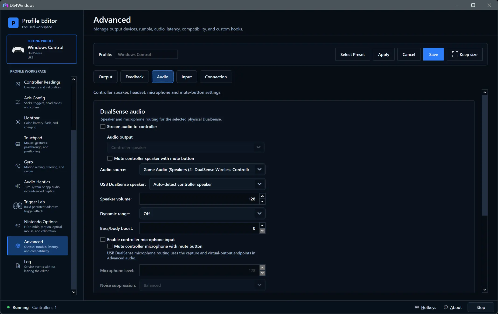

# Controller audio and game feedback

[Documentation index](README.md) · [Compatibility](controller-compatibility.md) · [Profile Editor](profile-editor.md#advanced)

## Choose the feedback source

| Source | What it does | Where to configure it |
| --- | --- | --- |
| Native game feedback | Receives the supported virtual controller's game-authored rumble, haptics, lighting and trigger effects | Advanced → Output, Feedback and Audio |
| Audio Haptics | Creates vibration from captured system or application sound | Audio Haptics page or editor tab |
| Trigger Lab | Supplies your persistent adaptive-trigger effects | Trigger Lab page or editor tab |
| DSX game mods | Receives supported mod trigger/light commands on this PC; no audio/PCM haptics | Settings → Integrations |

Controller **speaker audio** is another path: it plays sound through a speaker or
headset. It is not the same signal as advanced haptics. Start by testing one
source, then combine them deliberately. Trigger Lab overrides incoming adaptive
effects only on its enabled triggers; Audio Haptics offers Mix and Replace.

## Native DualSense feedback

1. Confirm the game supports DualSense features and ordinary controller input works.
2. In **Profile Editor → Advanced → Output**, choose a compatible DualSense output.
3. In **Advanced → Feedback**, keep game feedback to the physical controller enabled.
4. In **Advanced → Audio**, enable the required controller audio/speaker support.
   Select the VIIPER virtual `Wireless Controller` render endpoint for game audio;
   choose that endpoint in the game too when it offers a controller-audio choice.
5. Save and restart the game if the output changed. Disable overlapping Steam
   Input remapping for the game. Turn off Trigger Lab on triggers whose native
   effects you want to test, and disable Audio Haptics while checking native haptics.

A physical DualSense/Edge provides adaptive resistance. Other feedback can be
translated for supported hardware, but translation is not identical to that
controller's original effects. Do not infer native game support from an ordinary
rumble test. See [compatibility](controller-compatibility.md).

### USB native haptics

From 5.0.30, DS4Windows uses a separate USB route for the
native waveform channels of the matching virtual DualSense/Edge Windows audio
endpoint. It renders only the two actuator channels to the matching physical
controller; audible speaker streaming and Audio Haptics remain independent.
Both Windows audio endpoints must be enabled, unmuted and expose four-channel
audio. Profile speaker volume/mute does not scale these waveform channels.
Editor motor previews can also override native USB motor mode,
then restore the game's cached mode when the preview stops. Follow the [USB acceptance checks](validation/dualsense-bluetooth-haptics-backlog-test.md#quick-usb-acceptance-for-the-added-corrections).

## Indicator lights and application control

DualSense/Edge player and microphone indicators are under **Profile Editor >
Lightbar > Indicator LEDs**. Use **Passthru** plus **Device settings** to follow
application LED requests. A specific profile choice overrides them; returning to
Device settings in Passthru restores the latest remembered application state.
Normal mode retains the existing controller-specific policy. The orange light
does not itself configure or mute microphone audio; mute indication and DSX
commands retain their priority. See the [Lightbar guide](profile-editor.md#dualsense-indicator-leds)
for available patterns and Reapply indicators.

## Speaker and headset routing

Open **Profile Editor → Advanced → Audio**. Controls depend on physical model
and connection.

- **Stream audio to controller** enables the selected audio source.
- **Audio source** chooses the Windows render endpoint to capture. For native
  game/controller sound, use the virtual PlayStation endpoint matching the
  profile output rather than an unrelated desktop endpoint.
- **USB DualSense speaker** selects the physical Windows endpoint for a USB
  DualSense. Bluetooth streams directly to the supported physical controller.
- **Audio output** chooses **Controller speaker**, **Headset only**, or
  **Follow headphone jack**. Follow switches to AUX headphones when the physical
  controller reports headphones connected, then returns to the speaker on unplug.
  It is available for managed DualSense/Edge USB and Bluetooth audio and genuine
  DualShock 4 Bluetooth audio. DualShock 4 USB audio is handled by Windows.
  The manual choices remain available, and existing profiles retain their choice.
  An active Audio Haptics app-audio route override keeps its own routing choice.
- **Speaker volume** and the separate headset/AUX controls adjust their respective
  routes. Start at a low level, then raise it while testing the chosen endpoint.

Audio Haptics' **Play app through controller** can supply captured app audio to
this route. Its source override is shown in Advanced → Audio; choosing another
Audio source there releases the override.

For Bluetooth speaker audio, **Dynamic range** can raise quieter detail and
restrain loud effects; **Bass/body boost** changes body/bass emphasis. These
speaker-processing controls do not alter native advanced-haptics channels.
NVIDIA processing choices require the availability indicated by the UI.

## Microphone

Enable controller microphone input where available, then select the appropriate
input in the game, voice app or Windows sound settings. Adjust microphone level
and noise suppression after verifying that an unmuted signal is reaching the app.

Bluetooth PlayStation microphone routing uses the matching VIIPER virtual capture
endpoint. The virtual format follows the profile's output, so a physical model
and its virtual audio endpoint need not have the same name.

For USB/legacy microphone routes, expand **Advanced audio** and choose the
physical Windows capture source and the intended virtual-output render endpoint
as described there. For example, a separately installed virtual cable uses its
render side to receive microphone PCM; the voice app uses the cable's capture
side. These endpoint selectors are not required for the supported VIIPER
Bluetooth microphone route. DS4Windows does not install a virtual cable itself.

## DualSense mute button

**Mute Button Mutes Input/Output** is the master control for the profile's
mute-button routing behaviour. The speaker and microphone mute options depend
on that master toggle. **Enable mute button light** controls the LED; the LED
setting alone does not configure Windows microphone routing.

If **Mute button switches profiles** is enabled, choose the mute-on and mute-off
profiles. Ensure those profiles use the intended output/audio settings before
testing, so switching does not look like an unexplained routing change.

## Nintendo headset support

Switch 2 Pro uses its **USB** headset path and Windows Headphones/Microphone
endpoints. Bluetooth headset audio is unsupported. See
[Nintendo USB headset setup](nintendo-options.md#usb-headset).

## Collecting native-feedback diagnostics

Use **Log > Verbose logging**, restart, reproduce for 1–2 minutes and use
**Copy Text** to share the full log, labelled USB or Bluetooth. Disable verbose
logging after the capture. The physical-native timing summary remains available
while controller-speaker audio is streaming. Its USB completion measures the
HID write; Bluetooth completion measures transport ownership handoff. Neither
proves vibration strength or radio delivery. See the
[diagnostic field guide](troubleshooting.md#delayed-or-weak-dualsense-vibration).

## If sound or feedback is missing

Check the selected physical controller, USB/Bluetooth connection, virtual output,
endpoint and mute state. Confirm the game is sending the feature you expect.
After changing output, restart the game and reselect its audio device if needed.
Test with Audio Haptics and Trigger Lab disabled to isolate native feedback.

Use [Troubleshooting](troubleshooting.md#haptics-triggers-or-audio-do-not-work) and
[Log and diagnostics](user-guide.md#log-and-diagnostics). The
[Bluetooth audio/haptics reference](dualsense-bluetooth-audio-haptics.md) describes
transport, processing and lifecycle details for developers.
