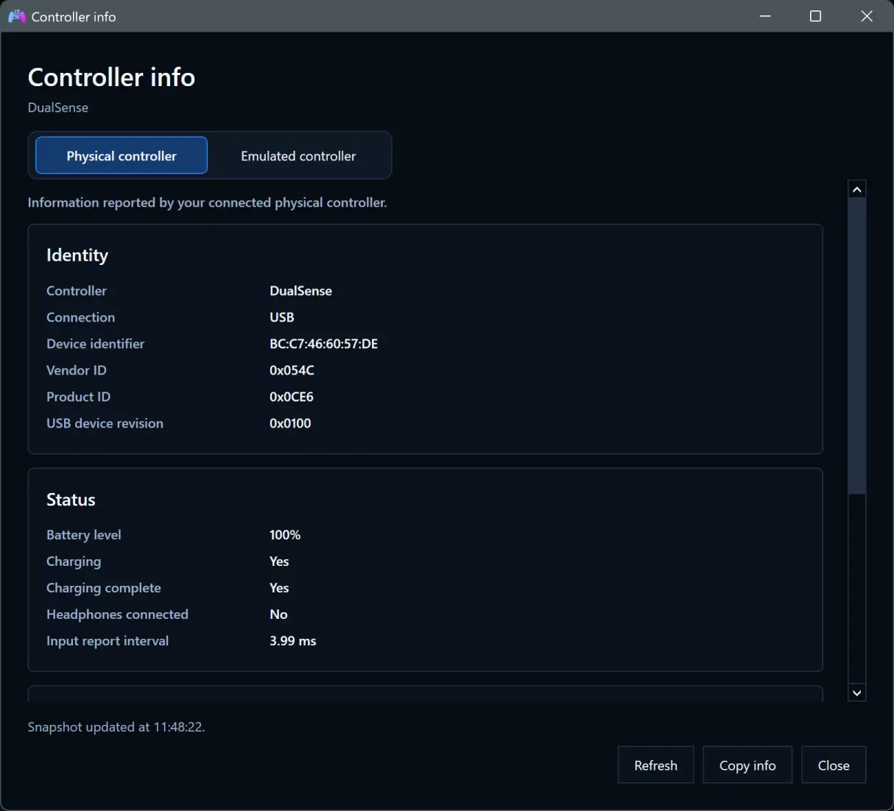

# Controller info

Open **Controller info** below the battery indicator in **Overview**, or on the
relevant card in **Controllers**. Both buttons open the same window for that
physical controller. You can keep separate windows open for different devices.

**Physical controller** shows information DS4Windows has already read from the
connected device: connection, available identifiers, battery, report interval,
and supported cached Sony firmware information. Opening the window does not
send new physical HID requests. Some devices do not provide firmware details.

**Emulated controller** shows what the virtual device reports, using a read-only
VIIPER request. This is distinct from the physical controller: its firmware date
and versions describe emulated controller firmware, not DS4Windows or your pad.

| Emulated controller | Available information |
| --- | --- |
| DualShock 4 | USB identity, factory build date/time and version fields, battery/status |
| DualSense / DualSense Edge | USB identity, factory build date/time, hardware/device/firmware fields, battery/status |
| Xbox 360 | USB identity and available public metadata; no invented firmware date |
| Xbox One | USB identity and public hardware/firmware/device versions |
| Switch 2 Pro | USB identity, battery band, charging, external power and voltage when available |

Exact fields depend on the controller and current backend state. Unsupported
fields are omitted or marked unavailable. Switch 2 battery bands are displayed
as bands, rather than an inaccurate percentage.

Use **Refresh** to take another snapshot, **Copy info** to copy both tabs as text,
and **Close** when finished. The window does not continuously poll VIIPER.
If the output controller changes, refresh to read its new information. If the
physical controller disconnects, the last snapshot remains available to copy.
Review identifiers such as serial numbers before sharing copied information.

## Backend requirement

Controller info was introduced with DS4Windows 5.0.49 and VIIPER 0.1.16. Use the
matching backend bundled with your current complete installer or portable package.
Backends older than 0.1.16 do not provide this information endpoint.
