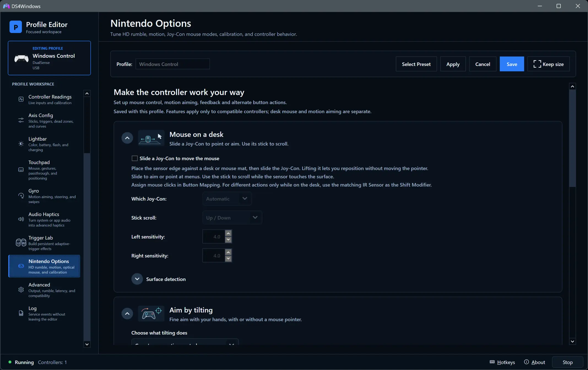

# Nintendo controllers and options

[Documentation index](README.md) · [Compatibility](controller-compatibility.md) · [Profile Editor](profile-editor.md)

Nintendo Options groups hardware-dependent features into cards. The controller
must expose the relevant hardware; selecting a Nintendo virtual output does not
add an optical sensor, motion sensor or headset port to a different physical pad.

## Connect and pair

For Switch 2 Pro, use USB or **Settings → Controllers** Bluetooth discovery and
association. Joy-Con 2 uses that Bluetooth setup. Hold the controller's sync
button until its lights flash, refresh discovery, select it and choose
**Associate selected**. Previously associated controllers can reconnect when
woken; sync mode is for associating a new controller.

Use **Link/Unlink** on Controllers to join or separate Joy-Cons, or enable
automatic pairing in Settings → Controllers. A pair requires a left and right
controller of the same generation. A single Joy-Con can work on its own.
Choose upright/sideways holding style on Controllers; that device choice takes
priority over the profile's starting holding style.

## Mouse on a desk

Joy-Con 2 optical mouse controls let you slide a controller on a surface to move
the pointer. Enable **Slide a Joy-Con to move the mouse**, choose the sensor side
and tune sensitivity. Place the sensor edge against a desk or mouse mat. Lift
the controller to reposition without moving the pointer.

Use its stick for the configured scrolling actions. Optical stabilization and
dampening options can steady movement while clicking. Original Joy-Cons do not
have this optical hardware; gyro mouse aiming is a different feature.

## Aim by tilting

Choose what tilting does, then configure **When to aim** and the selected mode's
sensitivity. A button condition controls when aiming runs; it does not select
which Joy-Con supplies motion.

Keep the controller still when calibrating motion. Use hold/toggle motion-lock
buttons to pause aiming, steady-aim buttons to suppress unwanted movement during
button presses, and slow-aim buttons for finer control. Start with basic aiming
working before adding those conditions.

## Dual Joy-Con aiming

For a joined pair, **Aim with both Joy-Cons (DJG)** controls how the two hands
supply motion: configure lead hand, side switching and pause buttons in
**Choose how the two hands work together**.

This does not pair controllers or enable mouse aiming. First configure
**Aim by tilting → When to aim**, then choose the motion source behaviour.
A separate aiming activation button remains an on/off control, not a hand selector.

## Feel game feedback

Use the rumble controls to tune supported Nintendo feedback and conversion.
Game-authored feedback needs a compatible virtual output and game. Nintendo
HD-rumble translation adapts feedback to the physical motors; it is not identical
to a physical DualSense and cannot add adaptive-trigger resistance. Keep
game-to-controller feedback enabled under **Advanced → Feedback** when using it.

## USB headset

For Switch 2 Pro, connect the controller by **USB** and attach a suitable headset.
Choose **Headphones (Switch 2 Pro Controller)** for playback and the controller's
Microphone endpoint for voice input in Windows or the application.

Bluetooth headset audio is unsupported. An AUX cable or headphones without a
microphone cannot establish headset-microphone support. Verify playback and
microphone separately before adding other audio processing.

## Give buttons a second job

Enable the second-action mode, choose hold or toggle buttons, then choose a
control and **Edit second action…**. The shortcut opens Shift Modifier with
Switch 2 Mode Shift selected for a new assignment; existing shift triggers are
kept. Assign the second action and save the profile.

Shift buttons are reserved for switching actions, so their normal game action
is not sent. Optional automatic second actions can follow mouse aiming, stick
aiming or steering; those choices do not enable aiming themselves.

## Point, scroll or tap with a stick

Assign mouse, scroll or button actions in **Button Mapping** first. Then use this
card to tune stick mouse speed, scrolling Tap/Hold behaviour and button-action
response. These helpers tune assigned actions rather than replacing the mapping
step. Use [Axis Config](profile-editor.md#axis-config) for ordinary stick response.

## Layout and battery

Choose Xbox or Nintendo face-button layout and a starting Joy-Con holding style
that matches how you play. Review button assignments after changing layout.
Battery options can disconnect after inactivity or after a set time, even while
playing; use the latter only when that behaviour is intended.

## Correct drift and stick range

**Calibrate sticks…** opens the guided Switch 2 calibration tool for an active
Switch 2 Pro/Joy-Con 2. It corrects centres/range without rewriting factory
settings. Original Joy-Cons use their built-in stick calibration; use profile
dead zones and response settings to tune them.

**Restart gyro calibration** requires a stable surface: keep the controller
still for at least five seconds. **Calibrate drift correction** uses the
Switch 2 compass sensor; follow the figure-eight instructions while game input
is paused. Original Joy-Cons have no compass sensor, so use gyro calibration
for their motion drift. Cancel the guided correction if you need to stop it.

**Vibrate when connected** provides a short readiness confirmation where supported.

Technical contracts and hardware evidence are available through
[Technical reference](reference.md) and the [protocol index](protocols/README.md).
