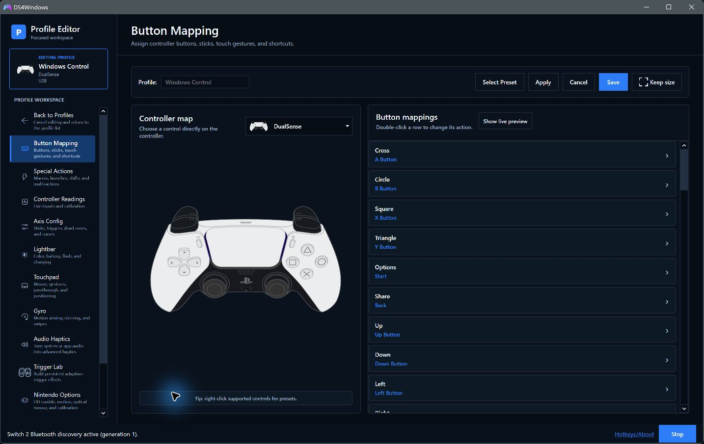

# Profile Editor

[Documentation index](README.md) · [Illustrated user guide](user-guide.md#profiles) · [Compatibility](controller-compatibility.md)

Create or select a saved profile on **Profiles**, or choose **Edit** for a device
on **Controllers**. Settings and preview availability depend on the selected
physical controller and virtual output.

## Saving and previewing

Use **Select Preset** for a starting configuration. **Apply** writes changes
while keeping the editor open; **Save** writes them and finishes editing.
**Cancel** or **Back to Profiles** cancels editing. **Keep size** preserves the editor window size. Moving between editor sections preserves edits.

Live previews let you feel or inspect a setting before finishing. A preview is
not evidence that a profile was saved. If a write fails, the editor stays open;
check Log and retry after resolving the file problem. The last valid profile is
preserved. See [profile recovery](user-guide.md#profiles) for rename failures and
unsaved Overview changes.

## Button Mapping

1. Choose the controller diagram layout that matches the labels you want to use.
2. Select a control on the diagram, or double-click its row in **Button mappings**.
3. Choose a controller button, keyboard key, mouse action or macro in the
   remapping dialog. Use a shift modifier for a separate action while its
   activation condition is met.
4. Save, then test the result in the target game or application.

**Show live preview** helps identify the control being pressed. A different
diagram layout changes how controls are presented; choose the virtual controller
in **Advanced → Output**. For conflicting mouse mappings, use the
[mouse-click troubleshooting guide](troubleshooting-mouse-clicks.md).

## Special Actions

Special Actions trigger behaviour from a button combination: macros, program
launches, profile shifts and Bluetooth disconnects are examples.

Choose **New Action**, give it a descriptive name, select its trigger combination
and configure the action. Then check its **Enabled** box for this profile.
Select a row to **Edit Action** or **Remove Action**; use **Export actions** to
share or back up an export. Save the profile after changing its enabled actions.

For example, a Bluetooth disconnect action can use PS + Options so an ordinary
game button does not disconnect the controller accidentally. Test combinations
for conflicts with your game. Read any Trigger Lab protection notice before
combining actions that also control triggers.

## Controller Readings

Use the live cards to check battery, observed physical report interval, sticks,
triggers, motion sensors and the first touchpad contact.

- **Input** is the physical reading; **Output** is the profile-mapped value.
- Blue plot markers represent input, gray markers output, and red areas show
  dead zones or drift.
- Sensor bars are read-only. Change response settings in Axis Config or Gyro.
- The observed report interval is not end-to-end game latency.

For stick drift, first leave the stick untouched and inspect Input, then compare
Output after changing its dead zone. Choose the readout controller under
**Advanced → Input** when editing with multiple connected devices.

## Axis Config

Choose **Left stick**, **Right stick**, **Triggers** or **Motion axes**. Begin with
the normal output mode before tuning response.

Enable **Show controller readings** to compare live Input/Output while adjusting
axes. In wide windows the readings sit to the left of the controls; in narrow
windows they stack below them. Both regions scroll independently. Turning it off
restores the full settings width. The separate Controller Readings page remains
available; the dock uses the same live view and calibration markers.

| Setting group | What to adjust |
| --- | --- |
| Dead zones | Suppress unwanted movement around centre; choose the available radial/axial controls for your use case |
| Max zone and max output | Control where full input is reached and the output ceiling |
| Anti-dead zone | Add initial output to overcome a game's own dead zone; too much can cause a jump near centre |
| Response shaping | Sensitivity, vertical scale, output curves and custom curves |
| Stick behaviour | Rotation, square-stick shaping, fuzz and anti-snapback |
| Outer-stick actions | Bind an action near the edge and adjust its activation threshold/inversion |
| Calibration | Inspect offsets and use automatic recalibration with the stick at rest |
| Delta acceleration | Optional response to changes in stick movement; tune only after the basic response works |
| Flick stick | Configure turn calibration, threshold and timing for a mouse-look game |

Change one setting at a time and compare Controller Readings. A large dead zone
can hide drift but also remove useful small movements. Trigger and motion-axis
pages have their own response controls; changing a stick does not tune them.
Follow [Flick stick calibration](flick-stick-calibration.md) for the in-game
360° test instead of guessing a calibration value.

## Lightbar

Choose **Output Mode** first. In normal mode, use **Profile colors** to adjust
RGB and optionally **Color by Battery %**. **Battery alert** selects a threshold,
flash/pulse pattern and alert color. **Charging** controls behaviour while charging.
**Rainbow and brightness** controls the cycle and maximum light level, including
the always-rainbow option.

Passthrough uses game-provided lighting with a compatible output/game. A
controller without the relevant lightbar hardware cannot reproduce that effect.

### DualSense indicator LEDs

**Indicator LEDs** controls the five white player lights below the touchpad and
the orange microphone light on DualSense/Edge. White-light choices include Off,
Player 1-4 patterns, All five lights and Battery level. The microphone light can
be Off, On or Pulse. These are profile settings, saved with Apply/Save.

| Lightbar output mode | Indicator selection | Behaviour |
| --- | --- | --- |
| Normal | Device settings | Keep the existing controller-specific policy; the microphone light defaults to Off. |
| Passthru | Device settings | Follow the latest game/application indicator request, using device settings until a request arrives. |
| Either | A specific choice | Override the application's indicator with the selected profile value. |

In Passthru, returning from Off to Device settings restores the latest remembered
application request without requiring it to be sent again. Player-light release
commands return control to the device policy. Existing microphone mute indication
and explicit DSX commands take priority. Changing the orange light does not mute
the microphone.

**Reapply indicators** applies the current editor selections without changing
profiles. It sends a fresh update even when Off was already selected. Close a
competing lighting application first when clearing lights it left on; an active
writer can send another command. Use Apply/Save to persist the selections.

## Touchpad

| Output mode | Purpose |
| --- | --- |
| Mouse | Relative pointer movement, taps, scrolling and optional trackball behaviour |
| Controls | Map touch regions/gestures to actions |
| Mouse joystick | Translate touch motion into stick-style output |
| Absolute mouse | Position the pointer using the touch surface |
| Passthrough | Let a compatible game use virtual-controller touch data |

For a desktop mouse, start with Slide and moderate sensitivity. Add Tap, Scroll,
Double Tap or Lower Right as RMB only if needed. Rotation changes movement
direction; minimum threshold and jitter compensation help with unwanted motion.
Trackball adds continued movement after a swipe, controlled by friction.

Review **Passthru Click Action (DS4 mode)** separately from pointer movement.
If **Start with Slide/Scroll Off** is enabled, enable movement through your chosen
touchpad toggle before expecting a response. Absolute mouse display selection
is in **Settings → Advanced**; profile-specific options are under Advanced → Input.

## Gyro

Choose whether motion drives controls, a mouse, stick-style aiming, steering or
passthrough. Then configure the selected mode's activation buttons, toggle/hold
behaviour and condition. Activating a mode and choosing its activation condition
are separate steps.

For motion mouse aiming, start with a simple activation condition, test direction
and sensitivity, then add smoothing if needed. For steering, choose the output
axis and range and use **Calibrate**. **Gyro Calibration** is separate from stick
calibration: keep the controller still while following the calibration prompts.

Use [Nintendo Options](nintendo-options.md) for motion lock, steady/slow aiming
buttons and dual Joy-Con motion-source choices. Those helpers do not enable
ordinary mouse/stick aiming by themselves.

### Stick-based gyro activation

Under **Gyro > Stick-based gyro activation**, choose a mode, stick and movement
threshold, then Apply or Save:

| Mode | Stick near centre | Stick beyond the threshold |
| --- | --- | --- |
| Off | Existing gyro behaviour | Existing gyro behaviour |
| Enable while stick is moving | Gyro paused | Gyro allowed |
| Pause while stick is moving | Gyro allowed | Gyro paused |

Select Left stick, Right stick or Either stick. Moving means **held away from
centre**, not repeatedly wiggling it; L3/R3 clicks alone do not count. Either
stays in the moving state until both sticks return near centre. The default
threshold is 15% of calibrated travel, independent of output dead zones; it
switches back below 13% to avoid rapid changes near the boundary. The threshold
can be set from 1% to 95%, with a two-percentage-point release gap.

For mapped aiming, the stick condition combines with existing activation buttons;
it does not bypass them. The condition also gates angular velocity sent to
virtual DS4, DualSense/Edge and Switch 2 outputs. Accelerometer/gravity data,
ordinary buttons/sticks and UDP/DSU motion remain active. A game's accelerometer
tilt can therefore still respond while gyro is paused. Older profiles default
to Off.

For a quick native-motion check, use DualSense emulation and **Gyro output:
Passthru**, select the virtual controller in a compatible tester, and watch its
Gyroscope values while rotating with the stick centred/deflected. This is
separate from Lightbar Passthru. Check mapped mouse/stick aiming separately if
you use it.

## Advanced

| Category | Purpose |
| --- | --- |
| Output | Virtual controller type, disabling virtual output, DS4 trigger output and optional Game Bar compatibility |
| Feedback | Game-to-controller feedback, rumble strength/auto-stop, motor tests, impulse-trigger translation and DualSense conversion |
| Audio | Controller speaker/headset routing, microphone processing and mute-button behaviour |
| Input | Mouse mapping sensitivity/acceleration, touchpad toggle, debouncing, absolute mouse options and live readout selection |
| Connection | Idle Bluetooth disconnect, DS4 Bluetooth polling preference and launching a program with the profile |

Hardware-specific controls follow the physical controller. **Send game feedback
to physical controller** enables the return path for supported game effects;
turning it off can remove rumble, haptics, triggers and game lighting. Reconnect
after changing this option as directed by its description.

Xbox impulse-trigger translation is separate from Trigger Lab. On DualSense/Edge,
the adaptive-trigger option chooses resistance/vibration output instead of body
rumble where supported. It cannot add adaptive hardware to other controllers.

See [Controller audio](controller-audio.md) and [Game Bar/integrations](integrations.md)
for setup. Audio Haptics and Trigger Lab also have dedicated editor pages;
their source/effect controls are explained in the
[Audio Haptics](user-guide.md#audio-haptics) and [Trigger Lab](user-guide.md#trigger-lab)
sections of the user guide.
