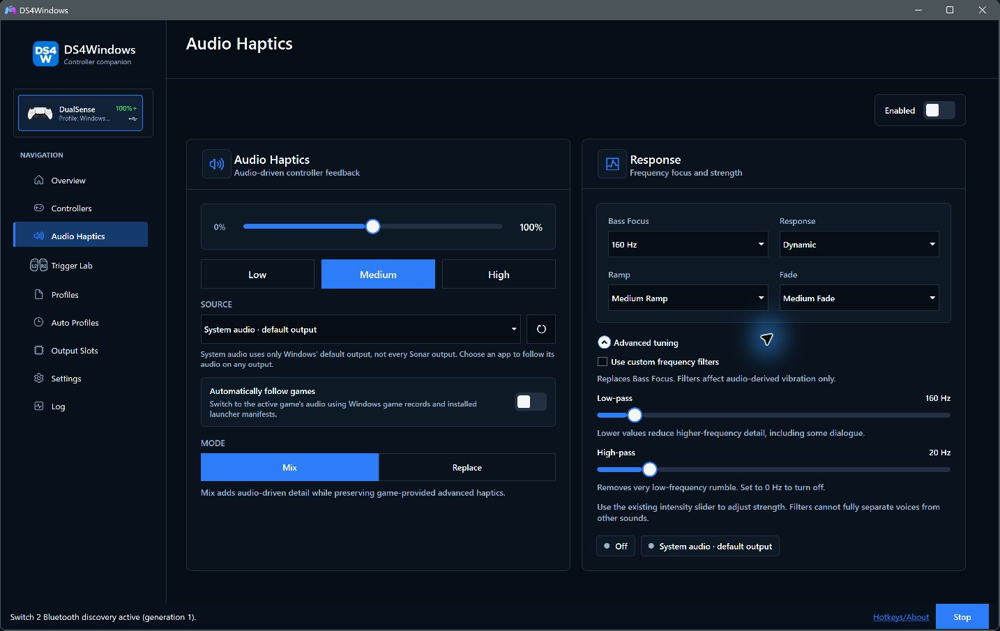
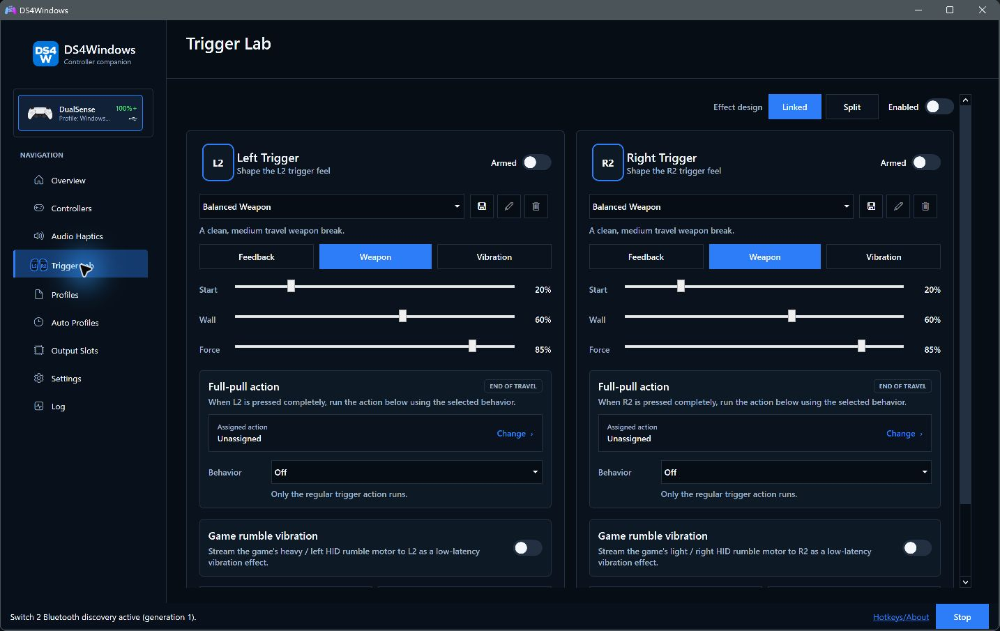
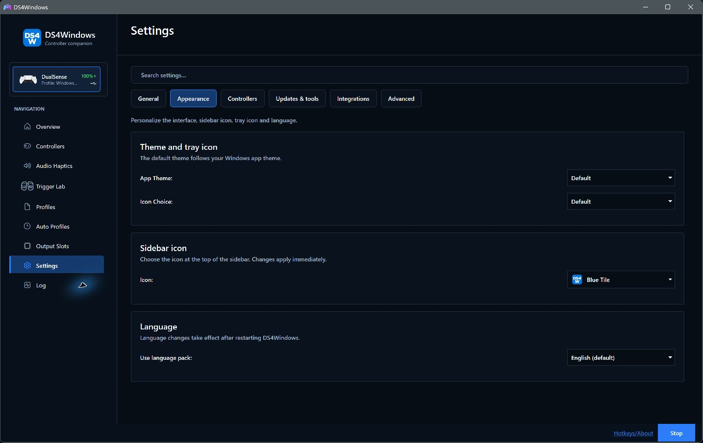
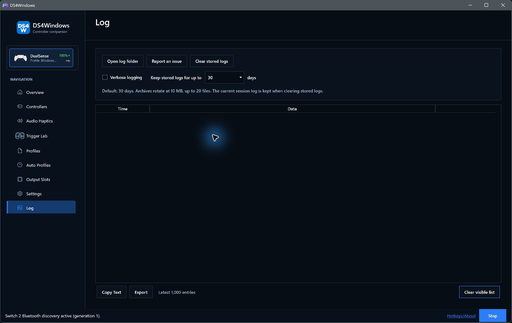

# A closer look at DS4Windows

[Documentation index](README.md) · [Getting started](getting-started.md)

These screenshots were captured from the .NET 10 [PR #56](https://github.com/Pav-Osmolski/DS4Windows/pull/56) test build on
19 October 2026, showing the interface released in 5.0.35. Selected options
illustrate the interface; they are not recommendations for every controller.

## Profile Editor

Build a mapping around your game, then fine-tune axes, gyro, lighting and
controller-specific behaviour. [Profile Editor guide](profile-editor.md).

## Audio Haptics

Turn system or application audio into vibration, with intensity, response and
optional frequency filters. Audio Haptics is separate from native game-authored
haptics. [Audio Haptics guide](user-guide.md#audio-haptics).

## Trigger Lab

Explore adaptive-trigger effects, presets and full-pull actions on compatible
hardware. [Trigger Lab guide](user-guide.md#trigger-lab).

## Appearance

Choose the app theme, sidebar artwork, tray icon and language. The sidebar icon
choice is saved independently of the tray icon.

## Log and diagnostics

Copy or export the current log, enable verbose details while troubleshooting,
and manage stored logs. The list is deliberately cleared in this screenshot;
no device identifiers or session logs are published here.

[Read the diagnostics guide](user-guide.md#log-and-diagnostics).
