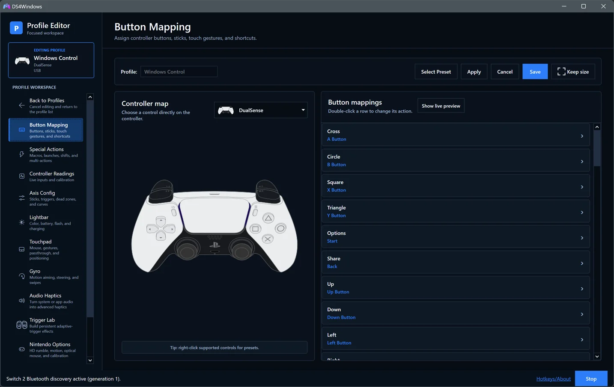
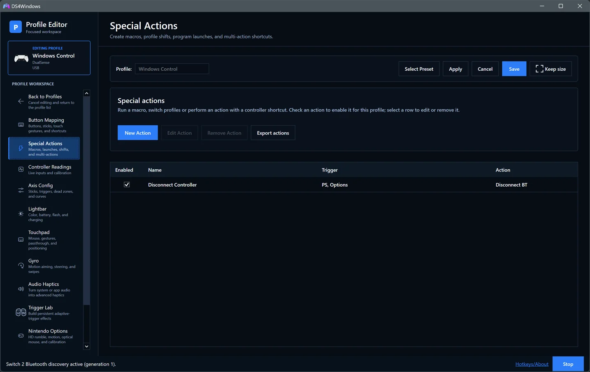
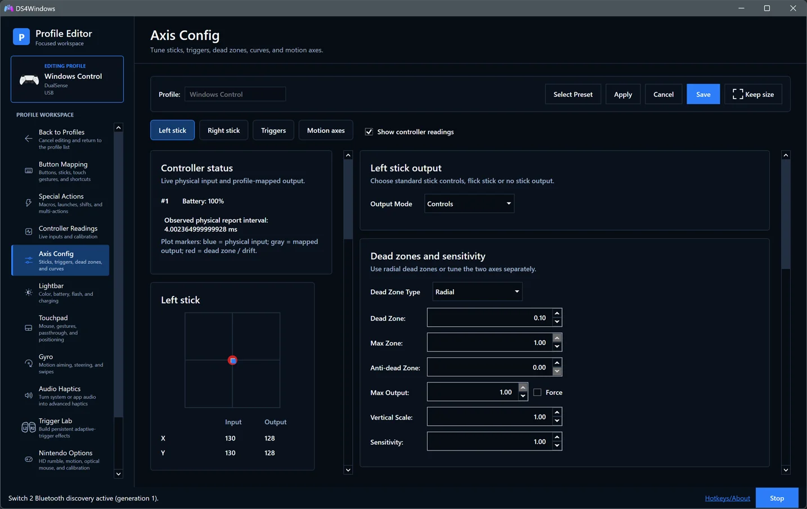

# A closer look at DS4Windows

[Documentation index](README.md) · [Getting started](getting-started.md)

These screenshots show the .NET 10 interface released in 5.0.35, with refreshed
WebP captures supplied by Pav-Osmolski on 20 October 2026. Some captures use the
[PR #56](https://github.com/Pav-Osmolski/DS4Windows/pull/56) test build and show
its earlier version label. Selected options illustrate the interface; they are
not recommendations for every controller.

## Overview

See connected controllers, active profiles and controller status at a glance.
[Overview guide](user-guide.md#overview).

## Controllers

Select a controller, assign its profile or open the editor.
[Controllers guide](user-guide.md#controllers).

## Profiles

Create, edit and manage saved profiles for different games and applications.
[Profiles guide](user-guide.md#profiles).

## Profile Editor

Build a mapping around your game, then fine-tune axes, gyro, lighting and
controller-specific behaviour. [Profile Editor guide](profile-editor.md).

### Button mapping

Choose a controller button, keyboard key, mouse action or macro for a control.
[Button Mapping guide](profile-editor.md#button-mapping).

### Special Actions

Create shortcuts for macros, profile shifts, program launches or Bluetooth
disconnects. Enable each action for the profiles that should use it.
[Special Actions guide](profile-editor.md#special-actions).

### Axis Config

Tune dead zones, sensitivity and response curves while comparing live physical
input with mapped output. [Axis Config guide](profile-editor.md#axis-config).

## Audio Haptics

Turn system or application audio into vibration, with intensity, response and
optional frequency filters. Audio Haptics is separate from native game-authored
haptics. [Audio Haptics guide](user-guide.md#audio-haptics).

## Trigger Lab

Explore adaptive-trigger effects, presets and full-pull actions on compatible
hardware. [Trigger Lab guide](user-guide.md#trigger-lab).

## Auto Profiles

Switch profiles automatically using application and window-title rules.
[Auto Profiles guide](user-guide.md#auto-profiles).

## Output Slots

Inspect virtual-controller slots and manage reservations.
[Output Slots guide](user-guide.md#output-slots).

## Settings

Find startup, appearance, controller, integration and advanced preferences in
focused sections. [Settings guide](user-guide.md#settings).

## Log and diagnostics

Copy or export the current log, enable verbose details while troubleshooting,
and manage stored logs. [Diagnostics guide](user-guide.md#log-and-diagnostics).

