# DS4Windows user guide

[Documentation index](README.md) · [Install and update](getting-started.md) · [Compatibility](controller-compatibility.md) · [Troubleshooting](troubleshooting.md)

DS4Windows reads a physical controller and presents the virtual controller
selected by your profile. Available settings depend on the controller and connection.

## Overview

Start here for a summary of your connected controller, active profile and backend status.

## Controllers

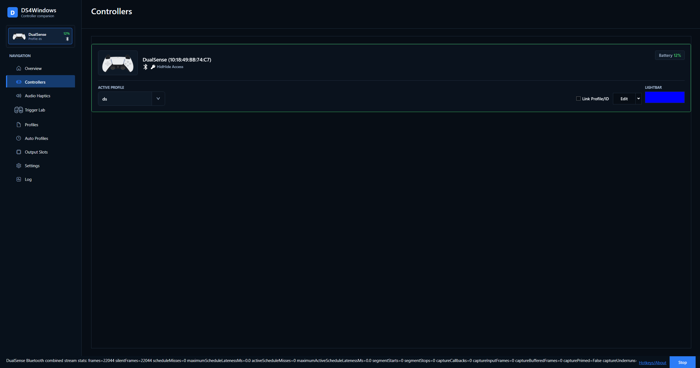

The Controllers page shows connected devices, battery, connection and selected
profile. Use the profile selector to choose a saved profile, and Edit to change
it. Link a profile to the controller ID when you want that device to reuse it.
Temporary changes and wireless disconnect controls apply to the selected device.

For Joy-Cons, use Link/Unlink or the automatic pairing option. A pair needs a
left and right controller of the same generation. Choose upright or sideways
orientation for a single Joy-Con. Switch 2 Bluetooth discovery and association
are available in **Settings → Controllers**; see [Nintendo setup and options](nintendo-options.md).

## Profiles

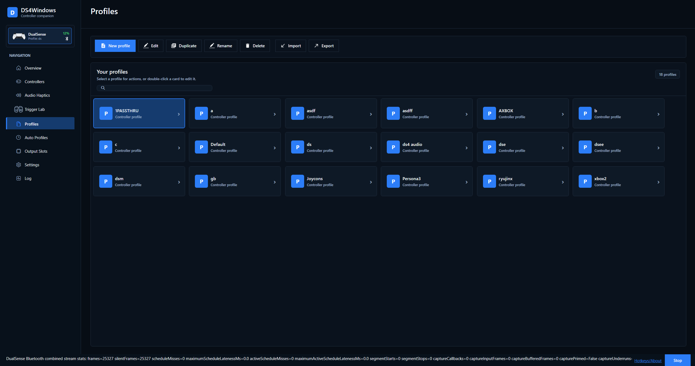

Create a profile from a preset, then choose the output device the game expects.
Xbox 360 is a useful starting point for XInput games. Choose DualShock 4 or
DualSense when the game supports that controller's features. Restart the game
after changing output type if it does not detect the new virtual controller.

You can rename, duplicate, import and export profiles from the Profiles page.

If saving fails, the editor stays open and the last valid profile file is kept.
Check Log for the file error, resolve permissions or free space, and retry.
A rename collision leaves both existing profiles unchanged; the Rename dialog
stays open so you can choose another name. If a save-based rename cannot remove
the original file, both complete copies are kept; check Log before removing any
copy yourself.

Overview quick settings apply live but still need a successful profile save.
If a write fails, Overview shows **Retry unsaved changes** and **Discard pending
saves**. Retry writes the captured changes to their original profile, even if
you have selected another profile. It refuses to overwrite a profile that has
since been edited or deleted. Discard cancels the pending saves without reverting
live settings. Pending saves are held only for this app session; resolve them
before closing DS4Windows. Before editing or renaming a profile with pending
Overview saves, retry or discard those saves first.

Back up your settings before deleting profiles or importing replacements.

### Edit a profile

The [Profile Editor guide](profile-editor.md) explains each page and common setup
tasks. Use [Nintendo Options](nintendo-options.md) and
[Controller audio](controller-audio.md) for hardware-specific features.

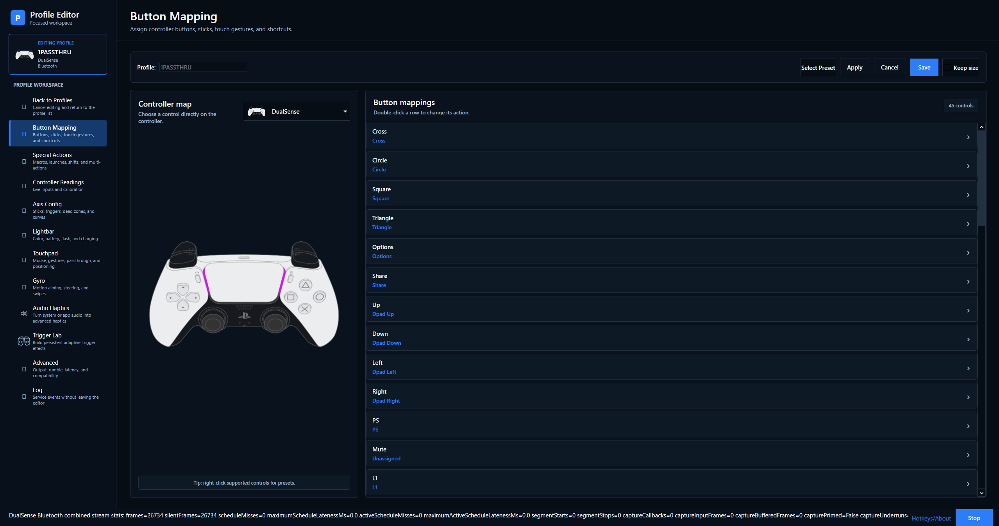

| Page | Purpose |
| --- | --- |
| Button Mapping | Map buttons, sticks, triggers and gestures to controller, keyboard, mouse or macro actions |
| Special Actions | Configure combinations, macros, launches and profile shifts |
| Controller Readings | Inspect live stick, trigger and motion input |
| Axis Config | Adjust dead zones, curves, sensitivity and flick stick |
| Lightbar | Set colour, battery indicators, flashing and passthrough |
| Touchpad | Choose mouse, gestures, controls, absolute positioning or passthrough |
| Gyro | Configure motion aiming, mouse output, steering or passthrough |
| Audio Haptics | Use system or application audio as a haptics source |
| Trigger Lab | Configure persistent adaptive-trigger effects |
| Nintendo Options | Configure supported rumble, motion, calibration and Joy-Con 2 optical-mouse features |
| Advanced | Use Output, Feedback, Audio, Input and Connection categories to configure output, rumble, controller audio, mouse mappings, latency and compatibility options. Hardware-specific controls follow the selected physical controller. |

Special Actions uses an **Enabled** checkbox for each action. Check it to use
that action in this profile. Select a row before choosing **Edit Action** or
**Remove Action**; **New Action** creates a shortcut and **Export actions** saves
an export. Long names and triggers wrap, and narrow windows allow horizontal
scrolling. Trigger Lab protection notices remain visible above the list.

Axis Config separates **Left stick**, **Right stick**, **Triggers** and **Motion
axes**. Stick pages group dead zones, response shaping, outer-stick actions and
calibration, with optional delta acceleration and flick-stick settings. Lightbar
groups profile colors, battery alerts, charging and rainbow brightness. Touchpad
and Gyro keep their output-mode selectors, with focused cards for the selected
mode, activation, smoothing and calibration. Changing sections preserves unsaved
edits; use **Apply** or **Save** to write them as usual.

Controller Readings groups live status, sticks, triggers, motion sensors and the
first touchpad contact into cards that wrap to the available width. **Input** is
the physical reading; **Output** is the profile-mapped value. Blue plot markers
show physical input, gray markers show mapped output, and red areas show dead
zones or drift. The observed physical report interval is not end-to-end latency.
Sensor bars are read-only; configure behavior on the other editor pages.

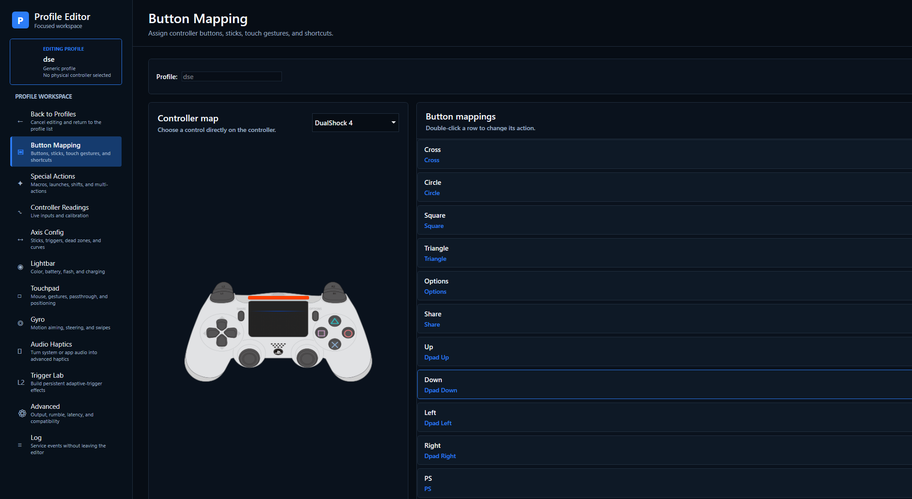

The controller diagram follows the selected controller layout; this example
shows a DualShock 4 layout, while the earlier image shows a DualSense.

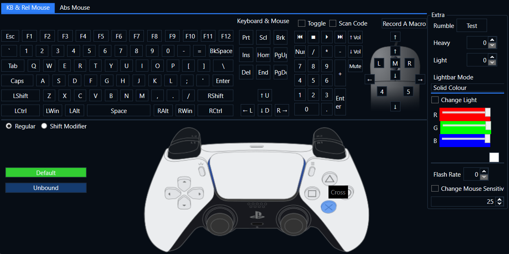

Select a mapped control to open the remapping dialog and choose its action.

Save to keep your edits. Back to Profiles cancels editing. Test one change at a
time, especially dead zones, gyro sensitivity and trigger effects.
Trigger Lab effects override game effects on the triggers where they are enabled.
Audio Haptics is separate from game-authored native DualSense haptics.

## Audio Haptics

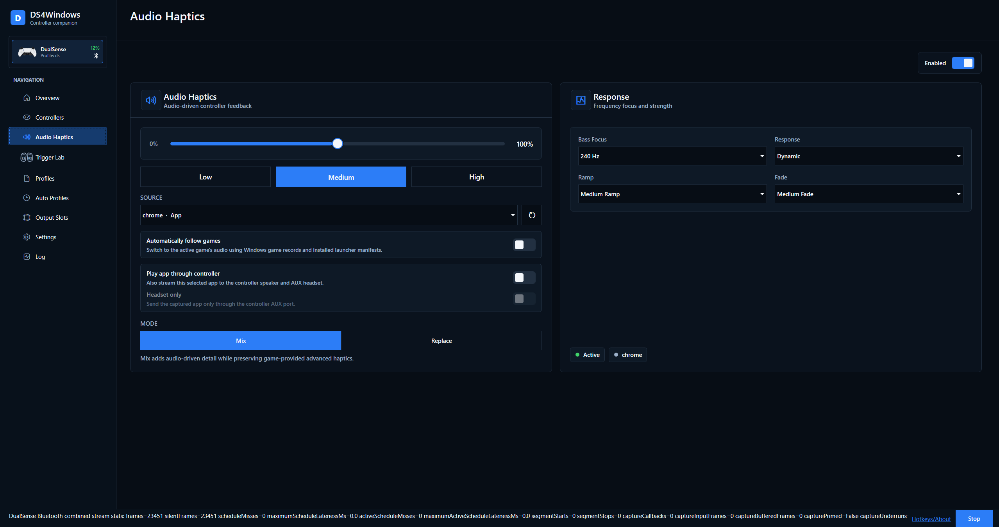

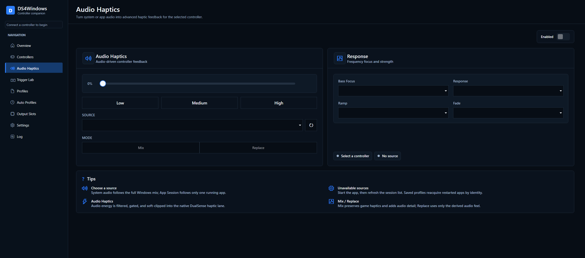

Audio Haptics creates feedback from sound; it is separate from native,
game-authored haptics. Use it on the main page for the selected controller, or
in the editor for the profile you are configuring.

1. Select a connected controller and enable Audio Haptics.
2. Choose **System audio** or a running application's audio session. Refresh
   sessions if the application is missing, and make sure it is producing sound.
3. Start with Low or Medium gain. Choose **Mix** to add audio-driven feedback to
   game haptics/rumble, or **Replace** to use only audio-derived feedback.
4. Tune **Bass Focus**, **Response**, **Ramp** and **Fade** while listening
   to a repeatable section of sound. Increase strength gradually.
5. In the editor, use Apply/Save to keep the profile configuration. Main-page
   changes are live profile changes; resolve any unsaved-change notice on Overview.

System audio uses Windows' default output, not every output from an audio router
such as Sonar. App capture follows the selected app on its output. **Automatically
follow games** switches to recognized games using Windows game records and
installed launcher manifests; the selected app remains the fallback. It does
not guarantee recognition of every game or launcher.

**Play app through controller** also streams the captured app to the controller
speaker/AUX headset on supported hardware. **Headset only** keeps it off the
built-in speaker. This overrides the Advanced audio source while enabled;
choosing another source there releases the override. See
[controller audio routing](controller-audio.md#speaker-and-headset-routing).

| Response control | Effect |
| --- | --- |
| Bass Focus | Choose the low-frequency region that contributes vibration |
| Response | Set how strongly peaks affect the feedback |
| Ramp | Control how quickly feedback rises |
| Fade | Control how quickly feedback falls after the sound stops |

For finer control, expand **Advanced tuning** and enable **Use custom frequency
filters**. This replaces Bass Focus for audio-derived vibration; leave it off
to keep the existing response. The settings are saved per profile:

- **Low-pass (40-1400 Hz):** lower values favour bass and reduce higher-frequency
  detail. Start around 100-160 Hz if dialogue causes too much vibration.
- **High-pass (0-200 Hz):** removes very low-frequency rumble. Set 0 Hz to disable
  it. The maximum stays at least 10 Hz below the low-pass setting.
- Use the existing intensity control for strength. Increase it gradually.

Filters affect audio-derived haptics, not audible audio or game-authored native
haptics. Voices, music and effects share frequencies, so these controls cannot
fully isolate dialogue. Compare a repeatable dialogue scene with an action scene
and adjust for each game. Disable custom filters to return to Bass Focus.

If feedback is absent, first verify the capture source, enable state and physical
controller. Test native feedback with Audio Haptics disabled so the two paths
are not confused. See [compatibility](controller-compatibility.md) for limitations.

## Trigger Lab

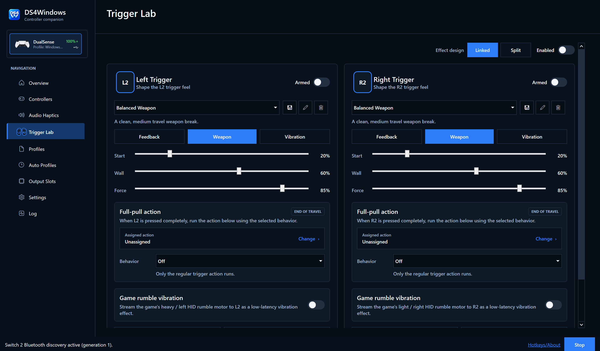

Trigger Lab designs persistent adaptive-trigger effects for physical
DualSense/Edge controllers. Choose a connected controller on the main page, or
configure the effect in a profile's Trigger Lab tab.

1. Choose **Linked** for matching effects on both sides or **Split** to edit L2/R2
   independently. Select an effect preset as a starting point.
2. Choose **Feedback**, **Weapon** or **Vibration**, then adjust Start, Wall and
   Force as applicable to that mode. Begin with low force.
3. Use **Preview L2/R2** to feel a temporary preview. Use **Reset L2/R2** to reset
   that side's Lab configuration; previewing alone does not save an effect.
4. Enable the intended side(s) and the master **Enabled** toggle. A side marked
   **Armed** is selected but the master override is not active.
5. Use **Save new trigger profile** to name a custom effect preset; custom presets
   can also be renamed or deleted. In the editor, Apply/Save writes the containing
   DS4Windows profile. A named trigger preset is not a separate controller profile.

Disable the master toggle or the relevant side to return that trigger to incoming
game effects. Lab effects take priority over native game and DSX mod effects on
that trigger; the other trigger can remain game-controlled.

**Full-pull action** assigns a second action at the end of travel. Choose how it
combines with the regular trigger action: Off, Add, Replace, Hair trigger or a
Hip fire mode with a delay. This is a mapping feature; it is distinct from the
physical resistance effect. **Game rumble vibration** can translate the game's
heavy/light rumble motor into L2/R2 vibration. Test each feature separately before
combining them, and check Special Actions protection notices for conflicts.

## Auto Profiles

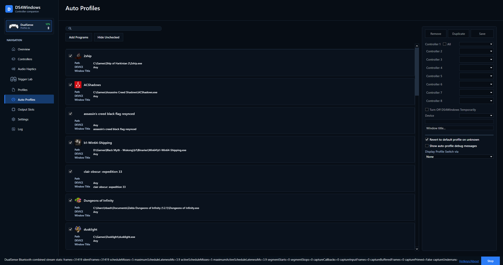

Auto Profiles selects saved profiles when the matching application/window is
active. First verify the intended profile works when selected manually.

For example, to use a gyro profile only in one game:

1. Create and save that profile on Profiles.
2. On Auto Profiles, use **Add Programs** to browse for the game's executable or
   add it from the available program sources. A launcher and the game itself
   may be different executables.
3. Select the entry, choose the profile for the intended controller slot (or All
   when that is intended), and Save. The read-only checkbox marks an existing
   saved rule; it is not an enable switch.
4. Launch/focus the game and confirm the active profile on Controllers.

For a window-title rule, use **Add Programs → Add Window Title Rule**, enter the
intended title condition and select/save its profiles. Use the title field to
narrow an application rule where needed. Search filters the displayed entries;
it does not change their matching configuration.

The **Device** choice restricts a rule to a controller family. For a matching
application/window, a matching device-specific rule takes priority over an Any
rule; the first matching rule within each group is used. Use the entry's context
menu **Move Up/Move Down** to order overlapping rules. A `(none)` profile does
not request a profile switch for that controller. Remove a saved rule when you
no longer want it to match.

**Revert to default profile on unknown** determines whether to return to the
default when no known rule matches. Leave the temporary-stop option off unless
the application should intentionally stop DS4Windows mapping. Review overlapping
rules and test one saved rule first if switching is unexpected. Optional
Auto Profiles debug messages help identify a match; disable them after diagnosis.

## Output Slots

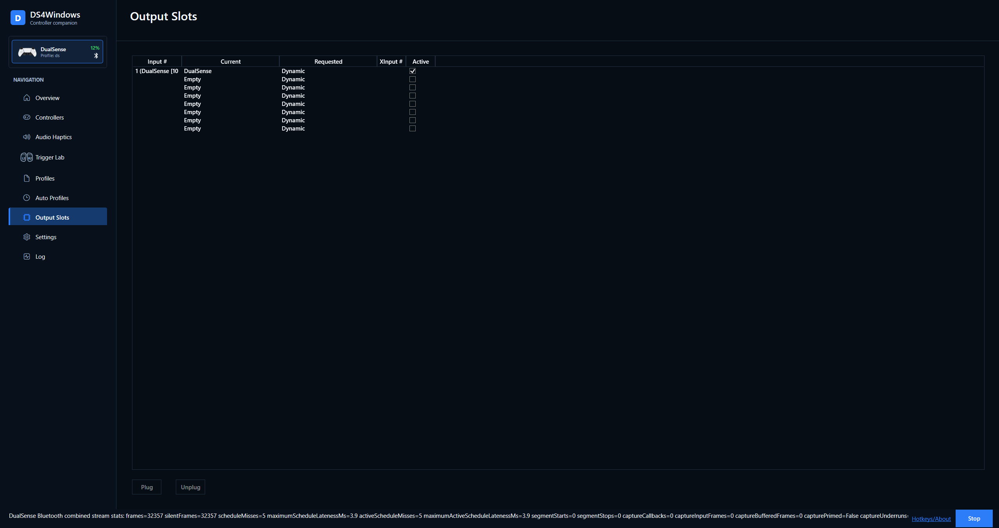

Use this page to see which physical controller feeds each virtual output slot.
**Slot** is DS4Windows' output slot number, not a game-reported XInput index.
**Current output** shows the virtual controller type. **Reservation** shows
Dynamic allocation or the type reserved permanently. **Input bound** means a
physical controller is feeding the slot.

**Auto-fit columns** uses the available window width. **Fit columns** restores
that layout. Dragging a column edge switches to manual sizing and saves the
widths with your application settings, including across restarts. Turning
Auto-fit off restores your last manual layout. Long names wrap; narrower windows
provide horizontal scrolling and full-text tooltips rather than hiding details.
Select a row to access Plug, Unplug and the existing reservation controls.
A failed disconnect can leave an output registered for retry; use the log to
diagnose it instead of repeatedly adding more outputs.

## Settings

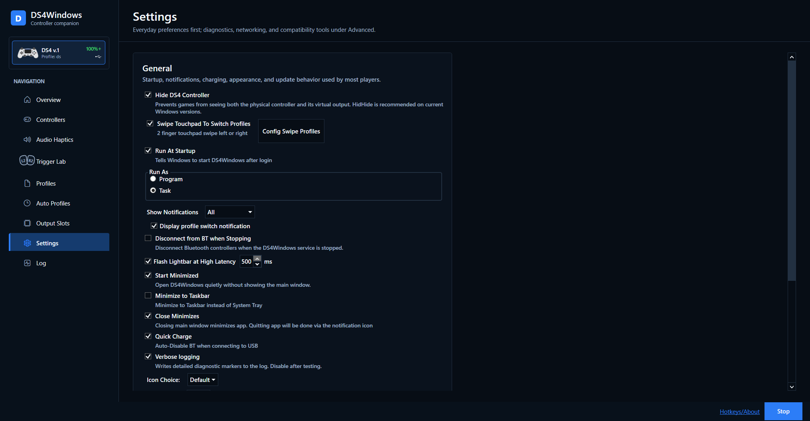

The image shows the General section of the redesigned Settings page. The checked
options are illustrative; your saved preferences may differ.

Settings fills the available window width and groups related options into cards.

| Section | What you can change |
| --- | --- |
| General | Startup, window behavior, notifications and latency warnings |
| Appearance | App theme, tray icon and language |
| Controllers | VIIPER setup, HidHide, Steam Input recovery, device options and swipe profiles; optional Nintendo pairing |
| Updates & tools | Update checks, profile folder, diagnostic utilities, verbose logging and optional profile-editor timing logs (off by default) |
| Integrations | DSX game mods, UDP motion output and OSC control/monitoring |
| Advanced | Custom Steam folder, executable name, process priority and absolute mouse display |

Search settings to find matching groups across all sections. Use **Ctrl+F** to
focus the search; **Clear**, or **Escape** while typing, returns to the selected
section. Searching keeps your edits. The app remembers the last selected section
when you close it normally.

Language changes show a restart reminder. A custom executable name shows a
re-launch reminder with the filename to open. Theme and tray icon changes apply
immediately.

Use [Swipe profiles](swipe-profiles.md) to limit profile cycling. For double
input, configure HidHide and check overlapping Steam Input mappings.
Run at Startup and Start Minimized are separate choices.

## Log and diagnostics

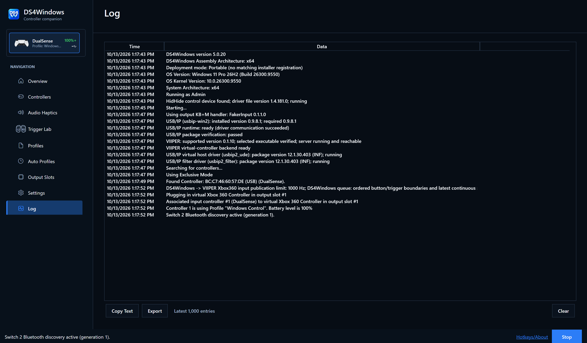

The Log page shows startup, controller, profile and backend events, including
installed/portable deployment mode, USB/IP status and detected driver versions.
**Copy Text** copies the retained latest 1,000 entries with timestamps, including
entries outside the current viewport. **Export** writes the same snapshot to a
text file. **Clear visible list** clears only this view; saved files remain.
Use **Open log folder** to find the active session and older saved logs. If the
startup has scrolled beyond the 1,000-entry limit, attach the saved log as well.

**Verbose logging** is available directly on the Log page and stays in sync
with the existing Settings control. Enable it, restart DS4Windows to include
startup diagnostics, reproduce the problem, then turn it off after collecting
the log. **Report an issue** opens this fork's GitHub issue form in your browser;
it does not upload a log or create a report automatically.

**Keep stored logs for up to** offers 1, 7, 14, 30 or 90 days; the default is
**30 days**. The preference persists across restarts. Archives also rotate daily
or at 10 MB and are capped at 20 files, so busy sessions may retain less history.
Cleanup runs after saved settings load and when you change retention; normal
archive rotation also enforces the limits.

**Clear stored logs** asks before deleting DS4Windows archives and saved startup
failure reports in the active Logs folder. It keeps the current session log,
the visible list, profiles and unrelated files. Locked or inaccessible files are
reported so you can try again later. Retention never deletes the active session
log or follows subfolders/links. Copy or export anything you need before clearing.

Include app version, Windows build, controller model, connection and output type
when reporting an issue. Startup readiness and driver versions help distinguish
a setup problem from a game/profile problem; they do not prove that a game's
feedback features work. Review logs for personal information before sharing.

Under **Settings → Updates & tools**, verbose logging adds diagnostic detail.
**Profile editor timing logs** is a separate opt-in setting, off by default,
for diagnosing editor opening phases. Enable only the information needed to
reproduce an issue, collect it, then turn it off. Auto Profiles has its own debug
message option. See [Troubleshooting](troubleshooting.md) for the first checks.

### XInput controller test

Open **Settings > Updates & tools > XInputChecker** to show the built-in XInput
controller test. It replaces the former external-program launcher; no separate
XInputChecker download is needed. Pressing the button again brings the same
window forward.

The four cards show Windows XInput slots 1-4, their connection status, pressed
buttons, trigger values (0-255) and signed raw stick values (-32768 to 32767).
Move each control to see which slot responds. These are Windows XInput slots,
not DS4Windows controller/output slot numbers. A physical Xbox controller and an
emulated Xbox output can each occupy a slot.

Virtual DS4 and DualSense outputs do not appear here; use a compatible PlayStation
tester for them. The test is read-only: it does not assign slots, create virtual
controllers, trigger rumble or measure latency. If Windows XInput is unavailable,
the window explains the error; close and reopen it to retry. Close the window
when finished.

## Native feedback and feature limits

See [Controller audio and game feedback](controller-audio.md) for setup and
[Compatibility](controller-compatibility.md) for controller/output/connection limits.

For native DualSense feedback, the game must support it, the profile must use
compatible output, and overlapping Steam Input remapping must be disabled for
that game. Controller audio/speaker support is needed for advanced haptics.
Supported feedback differs between controller models and USB/Bluetooth.

Nintendo rumble translation does not add adaptive-trigger hardware. Original
Joy-Cons do not have Joy-Con 2 optical mouse sensors. See the linked feature
guides before assuming a virtual output can reproduce every physical feature.
